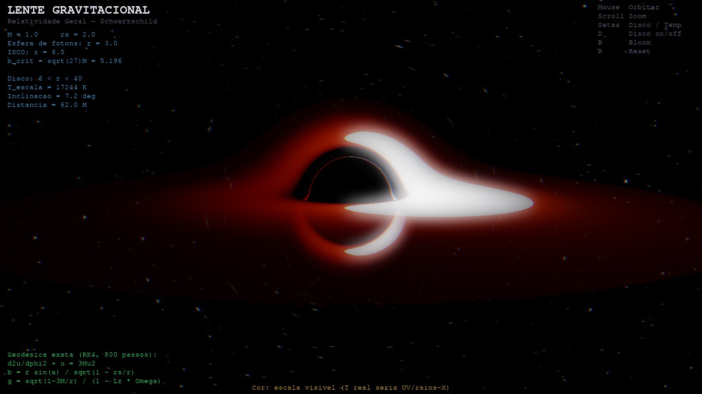

<div align="center">

# ⚛ physics-lab

**Interactive simulations of modern physics — from the Schrödinger equation to spacetime curvature — rendered on the GPU.**

[](LICENSE)
[](https://www.python.org/)
[](https://www.khronos.org/opengl/)
[](#architecture)

Read this in another language: **[Português](README-PT.md)**

<br>



<sub>Schwarzschild gravitational lensing — 800 RK4 steps per pixel, accretion disk with relativistic Doppler and a Novikov–Thorne profile</sub>

</div>

---

## About

physics-lab is a collection of **nine self-contained simulations** of quantum mechanics, special relativity, and general relativity. Each one is a standalone Python script you run directly. Wave functions are evolved with the Split-Step Fourier method; photon geodesics around a black hole are integrated *inside* a fragment shader; Lorentz boosts drive procedural clocks and contracting geometry. Results render in real time via OpenGL/ModernGL, or go straight into an `ffmpeg` pipe to produce MP4s.

This is a **personal educational project** — an exploration of numerical physics and GPU rendering, not a packaged library or a peer-reviewed scientific tool. It favors readable code and striking visuals over exhaustive rigor, and it is honest about where it approximates. See [Scope & honest caveats](#scope--honest-caveats) for exactly what each simulation does and does not compute.

---

## Highlights

- **Photon geodesics ray-traced in a shader.** A Schwarzschild black hole solved per-pixel: RK4 integrates `d²u/dφ² + u = 3Mu²` (800 steps/ray) directly in `blackhole.frag`, with event horizon, photon sphere, ISCO, a Novikov–Thorne accretion disk, gravitational + Doppler shift, and blackbody→sRGB color. This is the technical centerpiece.
- **Split-Step Fourier solver** (symmetric, 2nd order) in 1D and 2D. The same 2D core drives both the double-slit collapse and the EPR entanglement experiments. GPU acceleration via **CuPy is auto-detected** with a transparent NumPy fallback — the same code runs on CPU or GPU through `xp = cp if gpu else np`.
- **A small shared OpenGL engine** (`common/engine.py`): a 3.3 Core context, an HDR bloom pipeline (extract → separable Gaussian blur → composite), an orbital camera and a HUD — reused by five of the nine experiments.
- **Efficient video pipeline.** The 2D and Bell experiments bypass matplotlib entirely: they build frames as raw NumPy RGB arrays and stream them into `ffmpeg`'s stdin (`libx264`, crf 18).
- **Bilingual documentation** (English + Portuguese, mirrored) with screenshots for every experiment.

---

## The experiments

### General relativity (1)

| # | Name | What it does |
|---|------|--------------|
| 01 | `lente-gravitacional` | Interactive Schwarzschild black hole. Exact photon geodesics via in-shader RK4, accretion disk, gravitational lensing of a procedural starfield, redshift + relativistic Doppler. Pygame + ModernGL. |

### Quantum mechanics (4)

| # | Name | What it does |
|---|------|--------------|
| 01 | `schrodinger-1d` | Quantum tunneling. Split-Step Fourier 1D (grid 2048), NumPy on CPU, matplotlib viz (interactive or `--save`). |
| 02 | `dupla-fenda-colapso` | Double-slit + measurement collapse. 2D Schrödinger on a 1024² grid (1M cells), CuPy/GPU with NumPy fallback, frames piped to `ffmpeg`. |
| 03 | `emaranhamento` | EPR entangled state in 2D (same solver), produces three videos (evolution / correlations / collapse). |
| 04 | `bell-test` | CHSH inequality. **A statistical Monte-Carlo experiment** (see caveats) that reproduces `E(θ) = cos θ` and `S = 2√2` by direct sampling. Headless OpenGL (EGL), 4-panel 1920×1080 → `ffmpeg`. |

### Special relativity (4)

| # | Name | What it does |
|---|------|--------------|
| 01 | `dilatacao-temporal` | Time dilation with procedural clocks. |
| 02 | `contracao-lorentz` | Length contraction applied in the vertex shader (cube/sphere). |
| 03 | `transformadas-lorentz` | Interactive Minkowski diagram. |
| 04 | `paradoxo-gemeos` | The twin paradox on a spacetime diagram. |

All four special-relativity apps subclass `BaseApp` from the shared engine; the γ factor and Lorentz boost are computed in Python, the visuals in GLSL.

---

## Requirements

- **Python 3.9+**
- **`ffmpeg`** on your `PATH` — required by every `--save` command (called via `subprocess`; it is *not* a pip package).
- A GPU / display capable of **OpenGL 3.3 Core** for the interactive apps (special & general relativity). These open a Pygame window and do **not** run fully headless.
- **Linux with libEGL** for the Bell experiment specifically — it creates a headless EGL context and will not run out-of-the-box on Windows/macOS (see caveats).
- **NVIDIA GPU + CuPy** *(optional)* to accelerate the 2D quantum experiments. Without it they fall back to NumPy, which is considerably slower on the 1024² grid.
- **DejaVu fonts** (`fonts-dejavu-core`) for the Bell/2D HUD text — falls back to a default font if missing.

### Python dependencies

```bash
pip install numpy matplotlib pygame moderngl pillow
# optional, GPU acceleration for the 2D quantum experiments:
pip install cupy-cuda12x   # match your CUDA version
```

> **Heads-up:** the checked-in `requirements.txt` lists only `numpy`, `matplotlib`, `pygame`, `moderngl`. **Pillow is also required** by the double-slit, entanglement and Bell experiments — install it too, or those scripts fail with `ModuleNotFoundError: No module named 'PIL'`. `ffmpeg` and `cupy` are not pip-installable from that file either.

---

## Usage

Each experiment is a standalone entrypoint. **The theme directories contain spaces, so paths must be quoted.**

```bash
# General relativity — interactive black hole (window)
python "relatividade geral/01-lente-gravitacional/main.py"

# Special relativity — interactive (window)
python "relatividade restrita/01-dilatacao-temporal/main.py"

# Quantum tunneling — interactive
python "mecanica quantica/01-schrodinger-1d/main.py"
# ...or render it to tunneling.mp4
python "mecanica quantica/01-schrodinger-1d/main.py" --save

# Double-slit collapse, forcing CPU (NumPy) instead of CuPy
python "mecanica quantica/02-dupla-fenda-colapso/main.py" --save --cpu

# Bell test — render to bell_test.mp4 (needs EGL, Linux)
python "mecanica quantica/04-bell-test/main.py" --save
# ...or dump a single preview frame as PNG
python "mecanica quantica/04-bell-test/main.py" --preview 500
```

**Runtime flags:** `--save` (render to MP4 instead of showing a window), `--cpu` (force NumPy over CuPy), `--frames N` (frame count), `--preview N` (Bell: emit one PNG at step N).

A representative, minimal use of the simulation core (`01-schrodinger-1d`):

```python
sim = Schrodinger1D(X_MIN=-80, X_MAX=80, N=2048, DT=0.005, potential)
psi0 = sim.gaussian_packet(x0=-15, sigma=2, k0=5)   # kinetic energy = k²/2 = 12.5
frames = sim.evolve(psi0, n_steps=2000, save_every=8)
print(sim.norm(frames[-1]))                          # norm conservation check ≈ 1
animate(sim.x, sim.V, frames, DT, SAVE_EVERY, save_path)
```

---

## Technical spotlight: geodesics in a fragment shader

The black-hole experiment is the most unusual part of the repo. Rather than pre-tracing rays on the CPU, `blackhole.frag` (317 lines — the largest shader here) integrates the null-geodesic equation for every pixel, every frame:

```
d²u/dφ² + u = 3 M u²          where u = 1/r
```

solved with **RK4 over 800 steps per ray**. That gives correct light bending, the shadow of the event horizon, the photon sphere and the ISCO for free. On top of it: a Novikov–Thorne accretion disk, gravitational redshift combined with relativistic Doppler as a `g⁴·B(g·T)` intensity factor, and a blackbody→sRGB mapping (Mitchell Charity's approximation).

The physics here is honest about its limits — the geodesics are exact, but the disk intersection and the color/temperature mapping are deliberate approximations. See the caveats below.

---

## Scope & honest caveats

This is a learning project built in a short, focused burst. In the spirit of not overselling it, here is precisely what holds and what doesn't:

- **The Bell test is a classical Monte-Carlo simulation, not a quantum-state simulation.** It samples `P(same) = cos²(θ/2)` with an RNG and builds ±1 outcome pairs (`bell.py`). There is **no** state vector `|Φ⁺⟩`, no density matrix, no Pauli operators, no unitary collapse — it reproduces the *statistics* predicted by quantum mechanics, not the mechanism. The `S ≈ 2.87` you see is statistical noise around Tsirelson's bound `2√2 ≈ 2.83`, from sampling, not from an exact computation. Any "`|Φ⁺⟩`" or "Bloch sphere" labels are visual/pedagogical, not computed state.
- **There are no automated tests.** The only runtime "validation" is a printed norm-conservation check in the 1D solver. Treat the numerical methods as reasonable and readable, not as formally verified.
- **The Split-Step solver assumes a static potential.** The `exp(-iV·dt/2)` operators are precomputed once — correct for the fixed barriers used here, but not valid for a time-dependent `V(x, t)`.
- **The accretion-disk image is a first-order approximation.** The geodesics are exact RK4, but the disk-intersection radius is simplified (`r_cross = r`; see the comment in `blackhole.frag`) — good for small `dφ`, not exact.
- **The colors are qualitative, not photometric.** The temperature scale is an arbitrary visibility factor (a real disk would radiate in UV/X-ray); bloom and clamping are non-linear. Do not read the output as a calibrated image.
- **Portability is limited.** The Bell experiment requires **Linux + EGL**; DejaVu font paths are hardcoded under `/usr/share/fonts/truetype/dejavu/` (with an ugly fallback). The interactive apps are fine on any dedicated or integrated GPU from the last decade — the Bell headless renderer is not.

If you clone and run this, start with the interactive special-relativity apps or the 1D Schrödinger experiment — they have the fewest external requirements.

---

## Development

There is **no build step** — Python is interpreted and shaders are loaded from disk at runtime.

```bash
git clone https://github.com/JoaoHenriqueBarbosa/physics-lab.git
cd physics-lab
python -m venv .venv && source .venv/bin/activate
pip install numpy matplotlib pygame moderngl pillow
```

**Tests:** there is currently **no test suite**, so there is no test command — `pytest` finds nothing to run. The lines-of-code badge above is refreshed by CI. Contributions that add a `pytest` harness (for example, asserting norm conservation for the Split-Step solvers, or `S → 2√2` for the Bell sampler) are very welcome — see [CONTRIBUTING.md](CONTRIBUTING.md).

---

## Architecture

```
physics-lab/
├── requirements.txt              # 4 deps (also needs Pillow + ffmpeg + optional CuPy)
├── README.md / README-PT.md      # mirrored EN / PT docs
├── assets/                       # screenshots used by the READMEs
├── relatividade geral/
│   └── 01-lente-gravitacional/
│       ├── main.py               # Pygame + ModernGL app
│       └── shaders/blackhole.frag   # RK4 geodesics in-shader (the big one)
├── relatividade restrita/
│   ├── common/                   # SHARED engine
│   │   ├── engine.py             # BaseApp: GL 3.3, HDR bloom, orbital camera, HUD
│   │   └── shaders/              # bloom / blur / composite / grid / stars / clock / world
│   ├── 01-dilatacao-temporal/
│   ├── 02-contracao-lorentz/     # + cube/wire shaders (contraction in vertex shader)
│   ├── 03-transformadas-lorentz/ # + Minkowski diagram shaders
│   └── 04-paradoxo-gemeos/
└── mecanica quantica/
    ├── 01-schrodinger-1d/        # Split-Step 1D, matplotlib
    ├── 02-dupla-fenda-colapso/   # Split-Step 2D, CuPy/NumPy, ffmpeg pipe
    ├── 03-emaranhamento/         # EPR state, same 2D solver, 3 videos
    └── 04-bell-test/             # CHSH Monte-Carlo + headless EGL renderer
```

Notes: the general-relativity experiment reuses the special-relativity engine via `sys.path.insert`. The Bell experiment is the only one that does **not** use `common/engine.py` — it reimplements its matrices in NumPy inside its own renderer.

A little linear algebra runs through all of it, made concrete: the **Lorentz boost is a 2×2 operator** with `det = 1` acting on `(x, ct)`; the camera builds an **orthonormal basis via cross products**; the EPR state is a **45° rotation into sum/difference coordinates** that is not factorizable (Schmidt rank > 1); and the wave function is kept **L²-normalized**.

---

## Contributing

Issues and pull requests are welcome. Please read [CONTRIBUTING.md](CONTRIBUTING.md) for the setup and PR flow, and note the [Code of Conduct](CODE_OF_CONDUCT.md). Security reports go through [SECURITY.md](SECURITY.md).

---

## License

Released under the [MIT License](LICENSE).

---

<div align="center">
<sub>Built with Python, OpenGL, coffee, and one productive night. — João Henrique Barbosa</sub>
</div>
